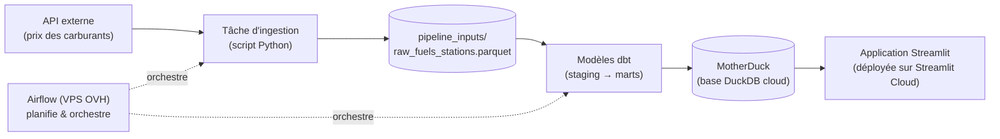

# ⛽ Fuels Platform — plateforme de données prix des carburants

Ce projet est une **plateforme de données complète**, construite de bout en bout : elle récupère automatiquement les données de prix des carburants, les transforme en modèles propres et fiables, les stocke dans une base analytique cloud, et les expose dans une application web interactive.

Ce README s'adresse à une personne qui découvre le projet : il explique **ce qu'il fait**, **comment il est construit**, et surtout **pourquoi** chaque choix technique a été fait.

## 🎯 Le projet en une phrase

> Toutes les 15 minutes, un pipeline automatique interroge une API de prix des carburants, transforme ces données brutes en modèles analytiques via dbt, les charge dans une base MotherDuck, et une application Streamlit permet de les explorer en lecture seule.

## 🏗️ Architecture générale



Le pipeline se lit de gauche à droite : donnée brute → zone d'atterrissage → transformation → stockage analytique → visualisation.

## 🔄 Étapes du pipeline, en détail

1. **Ingestion** — un script Python interroge l'API externe et écrit le résultat dans un fichier Parquet (`pipeline_inputs/raw_fuels_stations.parquet`). Le fichier est **écrasé** à chaque exécution : relancer le pipeline ne duplique jamais les données (on appelle ça l'**idempotence** — même opération jouée 1 ou 100 fois, même résultat).
2. **Transformation (dbt)** — le projet dbt lit le Parquet comme *source*, puis construit les modèles en deux étages :
   - `stg_*` (**staging**) : nettoyage, renommage, typage — une table stg = une source brute assainie ;
   - modèles **marts** : tables orientées analyse (dimensions, faits, indicateurs prêts à consommer).
3. **Chargement** — chaque `dbt build` écrit dans **MotherDuck**, une base DuckDB hébergée dans le cloud (schéma `prod`).
4. **Visualisation** — l'application Streamlit (déployée sur Streamlit Cloud) lit ces tables en **lecture seule** et propose exploration et visualisation. La fraîcheur des données dépend uniquement du pipeline : l'app n'a aucune logique de calcul.

## 🧩 Structure du dépôt

```text
fuels-platform/
├── airflow_orchestrator/        # Orchestration (Airflow)
│   └── dags/
│       ├── ingest_and_build_data.py   # Le DAG : ingestion puis dbt (via Cosmos)
│       └── scripts/                   # Scripts appelés par les tâches
├── dbt/                          # Projet dbt (transformation)
│   ├── models/
│   │   ├── staging/              #   stg_* : nettoyage des sources
│   │   └── marts/                #   tables analytiques finales
│   ├── profiles.yml              # Connexions (dev / prod) — chemins via variables d'env
│   └── dbt_project.yml
├── app_streamlit/
│   └── src/
│       ├── app.py                # Application Streamlit
│       └── requirements.txt      # Doit être à côté de app.py (contrainte Streamlit Cloud)
├── pipeline_inputs/              # Zone d'atterrissage (Parquet brut, écrasé à chaque run)
├── ingestion/                    # Scripts d'ingestion (API → Parquet)
├── docker-compose.yml            # Stack Airflow complète (API server, scheduler, dag-processor)
├── Dockerfile                    # Image Airflow personnalisée (avec venv dbt)
├── .env.example                  # Liste des variables d'environnement à définir (sans les valeurs)
└── dev_env.sh                    # Variables pour la session de dev locale (hors git)
```

## 🛠️ Choix techniques (et pourquoi)

| Choix | Pourquoi |
|---|---|
| **Airflow 3 sur un VPS OVH** (Docker Compose) | Orchestration planifiée toutes les 15 min, **ponctuelle et fiable** ; UI complète (historique des runs, retries automatiques, backfill pour rejouer une période après une panne). Le VPS fait tourner la production 24/7, indépendamment de toute session ouverte. |
| **dbt + Cosmos** | dbt transforme le SQL en projet versionné, testé et documenté. **Cosmos** intègre chaque modèle dbt comme une tâche Airflow visible dans le DAG : on voit, dans l'UI, quel modèle a échoué. |
| **DuckDB / MotherDuck** | DuckDB est une base analytique ultra-légère (un fichier, ou un service cloud avec MotherDuck). Parfait pour un pipeline de données embarqué, très rapide en lecture. MotherDuck gère la concurrence et centralise les données dans le cloud. |
| **Parquet comme zone d'atterrissage** | Format colonne, compact et standard : la donnée brute est conservée telle quelle, ce qui permet de rejouer les transformations sans re-appeler l'API. |
| **Streamlit Cloud** | Hébergement gratuit de l'app, redéploiement automatique à chaque `git push`, secrets gérés dans le dashboard. L'app reste une simple **lectrice** des données. |
| **Un seul code, deux environnements** | Les différences local/prod vivent dans des **variables d'environnement** (`DUCKDB_PATH`, `PIPELINE_INPUTS_DIR`, cible dbt `dev`/`prod`…), jamais en dur dans le code. Le `.env` du VPS joue ce rôle en prod ; `dev_env.sh` / `load_dotenv` en local. |
| **Versions épinglées** (ex. `duckdb==1.5.6`) | L'écosystème bouge vite : épingler garantit que l'image Docker est **reproductible** et que la version est compatible avec MotherDuck. |
| **Idempotence partout** | Parquet écrasé, marts **full-rebuild** : chaque étape peut être relancée sans risque. C'est ce qui rend le pipeline robuste aux pannes et aux retries. |

### Pourquoi full-rebuild plutôt qu'incremental sur les petites tables ?

Les marts font environ 100 lignes : les recalculer entièrement à chaque run prend quelques millisecondes et garantit des tables **toujours exactes et auto-réparantes**. Le mode `incremental` (n'ajouter que les nouvelles lignes) serait plus complexe, sans aucun gain — il se justifierait sur une table d'événements en forte croissance (ex. historique des relevés de prix).

## 🖥️ Les deux environnements

| | Local (dev) | Production |
|---|---|---|
| Machine | Votre poste | VPS OVH |
| Orchestrateur | Airflow dans un venv | Airflow en conteneurs Docker |
| Base de données | `dev.duckdb` (fichier local) | MotherDuck (`md:fuels_platform`) |
| Cible dbt | `dev` | `prod` |
| Variables | `dev_env.sh` / `.env` chargé par `python-dotenv` | `.env` injecté par Docker Compose |
| App | `streamlit run app.py` | Streamlit Cloud (redéploiement au push) |

Le même fichier DAG, les mêmes modèles dbt et le même code d'application tournent dans les deux mondes.

## 🔑 Variables d'environnement attendues

Voir `.env.example` pour la liste exhaustive. Les principales :

| Variable | Rôle |
|---|---|
| `PIPELINE_INPUTS_DIR` | Dossier de la zone d'atterrissage Parquet |
| `DUCKDB_PATH` | Base cible (fichier local en dev, `md:...` en prod) |
| `MOTHERDUCK_TOKEN` | Jeton d'accès au service MotherDuck |
| `DBT_TARGET` / `DBT_PROFILES_DIR` | Cible dbt et emplacement des profils |
| `AIRFLOW__CORE__EXECUTION_API_SERVER_URL` | Adresse de l'API server interne Airflow (nom du service Docker, pas `localhost`) |
| `AIRFLOW__API_AUTH__JWT_SECRET` | Secret partagé entre composants Airflow (signature des échanges internes) |

⚠️ **Aucun secret ne doit jamais être versionné** : `.env` et `dev_env.sh` sont dans `.gitignore`, et les secrets de l'app Streamlit sont configurés dans le dashboard Streamlit Cloud.

## 🚀 Démarrer le projet en local

```bash
# 1. Créer votre .env local (s'inspirer de .env.example) puis charger la session
source dev_env.sh

# 2. Lancer l'app
streamlit run app_streamlit/src/app.py

# 3. (optionnel) Tester le DAG complet
airflow dags test ingest_and_build_data <date>
```

## 📚 Pour aller plus loin

- La logique de transformation vit dans `dbt/models/` — chaque modèle est un fichier SQL versionné et testé.
- Le DAG (`airflow_orchestrator/dags/`) est le point d'entrée de l'orchestration : il enchaîne ingestion puis `dbt build`.
- Les choix de documentation (ce README) décrivent l'état de l'architecture ; les commits du dépôt racontent son histoire.