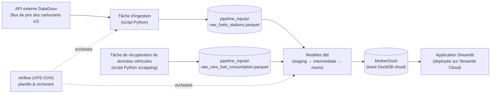

# ⛽ Economise pour du carburant — plateforme de données de prix des carburants

Ce projet est une **plateforme de données complète**, construite de bout en bout : elle récupère automatiquement les données de prix des carburants ainsi que des données de véhicules issues de scrapping, les transforme en modèles propres et fiables, les stocke dans une base analytique cloud. Les utilisateurs cherchent là où ils pourront économiser le plus dans une application web interactive en rentrant certaines informations (addresse, type de carburant, rayon d'action, quantité, marque/modèle/modèle moteur de voiture).

Adresse de l'application : https://economise-pour-du-carburant.streamlit.app/

## 🎯 Le projet technique en résumé

> Toutes les 3 heures, un pipeline automatique interroge une API de prix des carburants, transforme ces données brutes en modèles analytiques via dbt, les charge dans une base MotherDuck, et une application Streamlit permet de les explorer en lecture seule.

## 🏗️ Architecture générale



## 🔄 Étapes du pipeline, en détail

1. **Ingestion** — un script Python interroge l'API externe et écrit le résultat dans un fichier Parquet (`pipeline_inputs/raw_fuels_stations.parquet`).
2. **Transformation (dbt)** — le projet dbt lit le Parquet comme *source*, puis construit les modèles en deux étages :
   - `stg_*` (**staging**) : nettoyage, renommage, typage de la source brute de stations essence;
   - `int_*` (**intermediate**) : récupération et nettoyage d'une source brute obtenue (fichier Parquet) par scrapping de données d'un site de véhicule (https://www.fiches-auto.fr/consommation/) ;
   - modèles **marts** : deux tables (une pour les données de véhicules et leur consommation de carburant et celle montrant toutes les stations essence disponibles).
3. **Chargement** — chaque `dbt build` écrit dans **MotherDuck**, une base DuckDB hébergée dans le cloud (schéma `prod`).
4. **Visualisation** — l'application Streamlit (déployée sur Streamlit Cloud) lit ces tables en **lecture seule** et propose exploration et visualisation par openStreetMap. elle utilise aussi des scripts Python annexes (dossier `app_streamlit/utils` ) pour déterminer les stations à proximité de l'adresse écrite par l'utilisateur.

## 🧩 Structure du dépôt

```text
fuels-platform/
├── airflow_orchestrator/        # Orchestration (Airflow)
│   └── dags/
│       ├── ingest_and_build_data.py   # Le DAG : ingestion API + DBT (via Cosmos)
│       └── utils/               # dossier des scripts appelés par les tâches
├── dbt_pipeline/                # Projet dbt (transformation)
│   ├── models/
│   │   ├── staging/             #   stg_* : nettoyage des sources
    │   ├-- intermediate/        #   int_* : données intermédiaires
│   │   └── marts/               #   tables analytiques finales
    ├── pipeline_inputs/         #   dossier de données brutes (en local)
│   ├── profiles.yml             # Connexions (dev / prod) — chemins via variables d'env
│   └── dbt_project.yml          # Configurations générales des models DBT
├── app_streamlit/
│   ├── app.py                    # Application Streamlit
│   ├── pyproject.toml            # Doit être à côté de app.py (contrainte Streamlit Cloud)
│   └── utils/                    # Dossier des scripts pythons pour les calculs de mapping
├── docker/airflow/Dockerfile     # Image Docker Airflow personnalisée (avec venv dbt)
├── docker-compose.yml            # Stack Airflow complète sur Docker (API server, scheduler, dag-processor)
└── .env.example                  # Liste des variables d'environnement à définir
```

## 🛠️ Choix techniques (et pourquoi)

| Choix | Pourquoi |
|---|---|
| **Airflow 3 sur un VPS OVH** (Docker Compose) | Orchestration planifiée toutes les 3 heures, Le VPS fait tourner la production 24/7, indépendamment de toute session ouverte. |
| **dbt + Cosmos** | dbt transforme le SQL en projet versionné, testé et documenté. **Cosmos** intègre chaque modèle dbt comme une tâche Airflow visible dans le DAG : on voit, dans l'UI, quel modèle a échoué. |
| **DuckDB / MotherDuck** | DuckDB est une base analytique ultra-légère (un fichier, ou un service cloud avec MotherDuck). Parfait pour un pipeline de données embarqué, très rapide en lecture. MotherDuck gère la concurrence et centralise les données dans le cloud. |
| **Streamlit Cloud** | Hébergement gratuit de l'app, redéploiement automatique à chaque `git push`, secrets gérés dans le dashboard. L'app reste une simple **lectrice** des données. |

## 🔑 Variables d'environnement attendues (.env.example)

| Variable | Rôle |
|---|---|
| `MOTHERDUCK_TOKEN` et `MOTHERDUCK_DB` | Jeton d'accès au service MotherDuck & le nom de la table |
| `AIRFLOW_SECRET_KEY` | Secret partagé par l'API server (depuis Airflow 3.x c'est le nouveau nom du webserver de l'UI) |
| `AIRFLOW_JWT_SECRET` | Secret partagé entre composants Airflow pour la signature des échanges internes entre conteneurs (API server, scheduler, dag-processor) |
